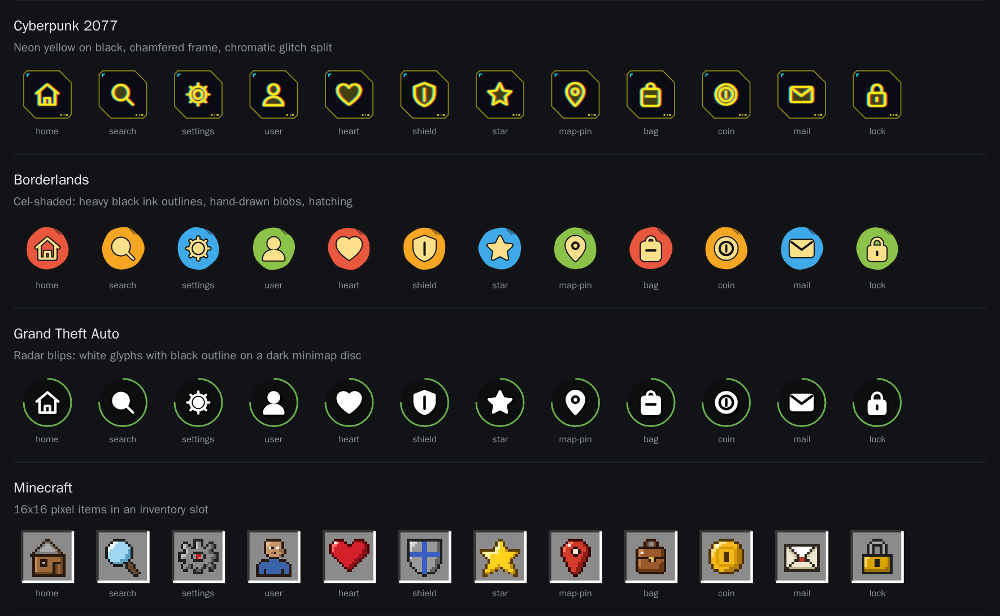

# Game Style Icons

12 interface icons redrawn in 20 styles inspired by video games: 240 SVGs, 64×64, no external fonts or images.



Icons: `home`, `search`, `settings`, `user`, `heart`, `shield`, `star`, `map-pin`, `bag`, `coin`, `mail`, `lock`.

## Styles

| Folder | Inspired by | Look |
|---|---|---|
| `cyberpunk-2077` | Cyberpunk 2077 | Neon yellow on black, chamfered frame, chromatic glitch split |
| `borderlands` | Borderlands | Cel-shaded: heavy black ink outlines, hand-drawn blobs, hatching |
| `gta` | Grand Theft Auto | Radar blips: white glyphs with black outline on a dark minimap disc |
| `minecraft` | Minecraft | 16x16 pixel items in an inventory slot |
| `fallout` | Fallout | Monochrome green CRT terminal with scanlines and phosphor glow |
| `zelda-botw` | Zelda: Breath of the Wild | Slate tablet UI: thin cyan lines, dotted rings, one orange spark |
| `halo` | Halo | Hexagonal HUD frame, cyan glow, corner brackets |
| `persona-5` | Persona 5 | Red burst, black slash, tilted white cut-out glyph |
| `hollow-knight` | Hollow Knight | Pale ink on deep night, thin ring and curled ornament |
| `hades` | Hades | Boon medallion: blood-red core, gold rings and rays |
| `portal` | Portal | Clean test-chamber tile, dark linework, orange and blue rings |
| `mass-effect` | Mass Effect | Orange holographic omni-tool rings and glow |
| `doom` | Doom | Riveted gunmetal plate, hellfire-orange glyph with hard outline |
| `splatoon` | Splatoon | Neon ink splats with drips, white glyph, rotating ink colours |
| `animal-crossing` | Animal Crossing | Soft cream card, leaf-green border, warm brown rounded lines |
| `hotline-miami` | Hotline Miami | Synthwave: magenta-to-cyan glow, VHS lines, ghost offset |
| `mirrors-edge` | Mirror's Edge | White minimal, black line glyph, runner-vision red highlight |
| `diablo` | Diablo | Gothic medallion: gold spikes and ring, bone glyph over blood red |
| `pac-man` | Pac-Man | Arcade maze: double blue walls on black, pellets |
| `overwatch` | Overwatch | Slanted slate card, orange stripe, bold white glyph |

More previews: [Fallout to Persona 5](docs/preview-2.png) · [Hollow Knight to Mass Effect](docs/preview-3.png) · [Doom to Hotline Miami](docs/preview-4.png) · [Mirror's Edge to Overwatch](docs/preview-5.png). Open `preview.html` for all of them.

## Use

Single file:

```html

```

Sprite (one file per style, every symbol id is `<style>-<icon>`):

```html
<svg width="48" height="48"><use href="sprites/hades.svg#hades-heart"/></svg>
```

The SVGs scale to any size. Some styles use SVG filters for glow (Cyberpunk, Fallout, Zelda, Halo, Hollow Knight, Mass Effect, Hotline Miami); every browser renders them, a few design tools ignore them. Each file has a `<title>` and `aria-label`.

## Change or extend

Everything is generated by `gen.py` (Python 3, no dependencies):

- **Glyphs**: `GLYPHS` holds each icon as stroke paths on a 24-unit grid. Each part is marked closed (a style may fill it), open, or an inner detail (drawn dark on filled styles).
- **Minecraft**: `PIXELS` holds hand-drawn 16×16 bitmaps with a small palette per icon.
- **Styles**: one function per style in `STYLES`, returning the 64×64 artwork.

```
python3 gen.py   # rewrites icons/, sprites/ and preview.html
```

## Note

Original artwork that borrows the general visual language of each game (colours, line treatment, frames). It contains no logos, characters, fonts or assets from any game. Game names are trademarks of their owners and are used only to describe the style; this project is not affiliated with or endorsed by any of them.

MIT licence.
