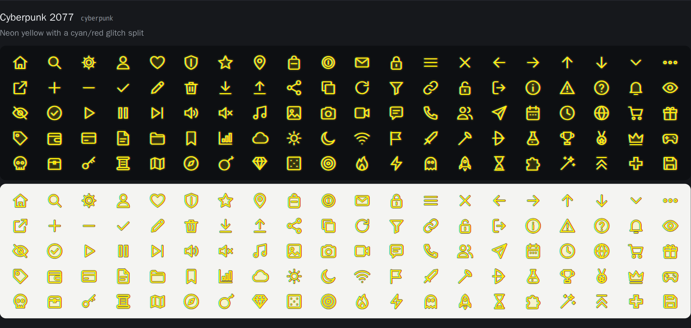

# Game Style Icons

100 icons in 20 styles inspired by video games, as **React components** (like react-icons) and plain SVGs: 2,000 icons, no backgrounds, tree-shakable.



## Install

From GitHub (until it is published on npm):

```
npm install github:horlesq/game-style-icons
```

React 18 or newer.

## Use

```jsx
import { CyberpunkHeart, CyberpunkCoin } from 'game-style-icons/cyberpunk';
import { MinecraftStar } from 'game-style-icons/minecraft';

<CyberpunkHeart />                       // 1em, follows the font size
<CyberpunkCoin size={32} title="Coins" />  // accessible name; without title the icon is aria-hidden
<MinecraftStar className="icon" style={{ verticalAlign: 'middle' }} />
```

Every component forwards its `ref` and passes any other prop to the `<svg>` (`className`, `style`, `onClick`, ...). Import from the style's path (`game-style-icons/hades`) or from the root (`game-style-icons`); unused icons are dropped by your bundler. TypeScript types are included (`GameIconProps`, `GameIcon`, from any import path).

Without React, use the files in `svg/<style>/<icon>.svg` (24×24).

Icons in each style (100). Component name = style prefix + icon, e.g. `HollowKnightMapPin`, `PacManSword`, `MinecraftPotion`.

- **Basics:** `Home`, `Search`, `Settings`, `User`, `Heart`, `Shield`, `Star`, `MapPin`, `Bag`, `Coin`, `Mail`, `Lock`
- **Navigation:** `Menu`, `Close`, `ArrowLeft`, `ArrowRight`, `ArrowUp`, `ArrowDown`, `ChevronDown`, `More`, `ExternalLink`
- **Actions:** `Plus`, `Minus`, `Check`, `Edit`, `Trash`, `Download`, `Upload`, `Share`, `Copy`, `Refresh`, `Filter`, `Link`, `Unlock`, `Logout`
- **Status:** `Info`, `Warning`, `Help`, `Bell`, `Eye`, `EyeOff`, `CheckCircle`
- **Media:** `Play`, `Pause`, `Skip`, `Volume`, `Mute`, `Music`, `Image`, `Camera`, `Video`
- **People and talk:** `Chat`, `Phone`, `Users`, `Send`, `Calendar`, `Clock`, `Globe`
- **Shopping:** `Cart`, `Gift`, `Tag`, `Wallet`, `Card`
- **Files and data:** `File`, `Folder`, `Bookmark`, `Chart`, `Cloud`
- **Everyday:** `Sun`, `Moon`, `Wifi`, `Flag`
- **Game:** `Sword`, `Axe`, `Bow`, `Potion`, `Trophy`, `Medal`, `Crown`, `Gamepad`, `Skull`, `Chest`, `Key`, `Scroll`, `Map`, `Compass`, `Bomb`, `Gem`, `Dice`, `Target`, `Fire`, `Zap`, `Ghost`, `Rocket`, `Hourglass`, `Puzzle`, `Magic`, `LevelUp`, `Health`, `Save`

## Styles

| Import (click for all 100) | Prefix | Inspired by | Look |
|---|---|---|---|
| [`cyberpunk`](docs/cyberpunk.png) | `Cyberpunk…` | Cyberpunk 2077 | Neon yellow with a cyan/red glitch split |
| [`borderlands`](docs/borderlands.png) | `Borderlands…` | Borderlands | Cel-shaded: heavy black ink outline, flat colour, comic drop shadow |
| [`gta`](docs/gta.png) | `Gta…` | Grand Theft Auto | Radar blip: white glyph, black outline, soft shadow |
| [`minecraft`](docs/minecraft.png) | `Minecraft…` | Minecraft | 16x16 pixel items |
| [`fallout`](docs/fallout.png) | `Fallout…` | Fallout | Phosphor-green terminal line with glow |
| [`zelda`](docs/zelda.png) | `Zelda…` | Zelda: Breath of the Wild | Thin cyan slate line, soft glow, one orange spark |
| [`halo`](docs/halo.png) | `Halo…` | Halo | Square-cut cyan HUD line with glow |
| [`persona`](docs/persona.png) | `Persona…` | Persona 5 | Tilted white cut-out, black outline, red offset |
| [`hollow-knight`](docs/hollow-knight.png) | `HollowKnight…` | Hollow Knight | Pale thin ink with a faint halo |
| [`hades`](docs/hades.png) | `Hades…` | Hades | Gold line over blood red, dark outline, ember glow |
| [`portal`](docs/portal.png) | `Portal…` | Portal | Clean line in your text colour, blue details, orange and blue rings |
| [`mass-effect`](docs/mass-effect.png) | `MassEffect…` | Mass Effect | Orange holographic line with glow |
| [`doom`](docs/doom.png) | `Doom…` | Doom | Hellfire-orange solid, hard dark outline, hot edge |
| [`splatoon`](docs/splatoon.png) | `Splatoon…` | Splatoon | Neon ink fill, dark outline, ink droplets; colour changes per icon |
| [`animal-crossing`](docs/animal-crossing.png) | `AnimalCrossing…` | Animal Crossing | Warm brown rounded line, honey fill, a leaf |
| [`hotline-miami`](docs/hotline-miami.png) | `Hotline…` | Hotline Miami | Magenta-to-cyan gradient, glow and ghost offset |
| [`mirrors-edge`](docs/mirrors-edge.png) | `MirrorsEdge…` | Mirror's Edge | Minimal line in your text colour with runner-vision red |
| [`diablo`](docs/diablo.png) | `Diablo…` | Diablo | Bone-gold line over blood red, black outline, red glow |
| [`pac-man`](docs/pac-man.png) | `PacMan…` | Pac-Man | Arcade maze: double blue walls, hollow inside |
| [`overwatch`](docs/overwatch.png) | `Overwatch…` | Overwatch | Bold white line, orange fill, slate edge |

`portal` and `mirrors-edge` draw their main line in `currentColor`, so they follow your text colour. The other styles keep their own palette; the glowing ones have a thin dark rim so they also read on light backgrounds.

Click a style name above to see its 100 icons on dark and light, or open `preview.html`.

## Change or extend

Everything is generated by `gen.py` (Python 3, no dependencies) from `glyphs.py`:

- `GLYPHS`: each icon as stroke paths on a 24-unit grid; parts are closed (may be filled), open, or inner details (drawn dark on filled styles).
- Minecraft: the first 12 items are hand-drawn 16×16 (`PIXELS` in `glyphs.py`); the rest are rendered from the vector glyphs by `pixelize.py` (a small path rasteriser with Minecraft-style outline, light edge and shade) in a material colour per icon (`MATERIAL` in `gen.py`).
- `STYLES` in `gen.py`: one function per style. Glows are drawn as soft wide strokes (no SVG filters); the few masks and gradients get unique ids per rendered icon.

```
python3 gen.py   # rewrites src/, svg/, icons.json and preview.html
```

## Note

Original artwork that borrows the general visual language of each game (colours, line treatment, effects). It contains no logos, characters, fonts or assets from any game. Game names are trademarks of their owners and are used only to describe the style; this project is not affiliated with or endorsed by any of them.

MIT licence.
