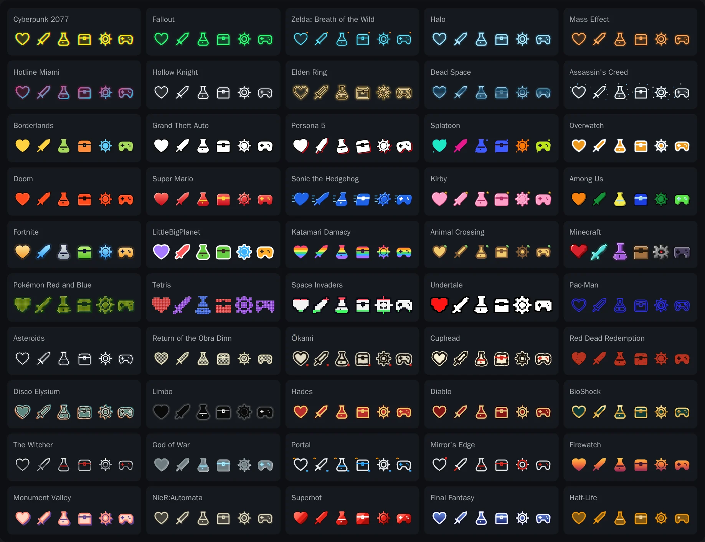

# Game Style Icons

100 icons in 50 styles inspired by video games, as **React components** (like react-icons) and plain SVGs: 5,000 components. No backgrounds, no fonts, no dependencies besides React, tree-shakable.



## Install

```
npm install github:horlesq/game-style-icons
```

Not on npm yet. Needs React 18 or newer. Without React, copy the SVG files from `svg/`.

## Use

```jsx
import { CyberpunkHeart, CyberpunkCoin } from 'game-style-icons/cyberpunk';
import { MinecraftSword } from 'game-style-icons/minecraft';
import { EldenRingPotion } from 'game-style-icons/elden-ring';

<CyberpunkHeart />                           // 1em: follows the font size
<CyberpunkCoin size={32} title="Coins" />      // accessible name; without a title the icon is aria-hidden
<MinecraftSword className="icon" style={{ verticalAlign: 'middle' }} />
<EldenRingPotion size="2rem" onClick={drink} />
```

| Prop | Default | |
|---|---|---|
| `size` | `'1em'` | Width and height (number = px, or any CSS length). |
| `title` | none | Accessible name. Without it the icon gets `aria-hidden`. |
| anything else | | Passed to the `<svg>`: `className`, `style`, `onClick`, `aria-*`... The `ref` is forwarded. |

Import from a style's path (`game-style-icons/hades`) or from the root (`game-style-icons`); `"sideEffects": false` lets your bundler drop the icons you don't use. TypeScript types are included (`GameIconProps`, `GameIcon`) on every path. An icon is about 2 KB of markup on average (simple line styles about 0.6 KB; pixel and hand-drawn styles 3.5 to 5.5 KB).

Plain SVGs are in `svg/<style>/<icon>.svg` (also importable as `game-style-icons/svg/<style>/<icon>.svg`), and `icons.json` lists every style, its prefix, category and component names.

## Styles

Component name = style prefix + icon name, e.g. `HollowKnightMapPin`, `PacManSword`, `TetrisGem`. Click a style to see all its icons on dark and light. Or clone the repo and open `preview.html`.

<!-- styles:start -->
### Neon and glow

| Import path (click: all 100) | Prefix | Inspired by | Look |
|---|---|---|---|
| [`cyberpunk`](docs/cyberpunk.webp) | `Cyberpunk…` | Cyberpunk 2077 | Neon yellow with a cyan/red glitch split |
| [`fallout`](docs/fallout.webp) | `Fallout…` | Fallout | Phosphor-green terminal line with glow |
| [`zelda`](docs/zelda.webp) | `Zelda…` | Zelda: Breath of the Wild | Thin cyan slate line, soft glow, one orange spark |
| [`halo`](docs/halo.webp) | `Halo…` | Halo | Square-cut cyan HUD line with glow |
| [`mass-effect`](docs/mass-effect.webp) | `MassEffect…` | Mass Effect | Orange holographic line with glow |
| [`hotline-miami`](docs/hotline-miami.webp) | `Hotline…` | Hotline Miami | Magenta-to-cyan gradient, glow and ghost offset |
| [`hollow-knight`](docs/hollow-knight.webp) | `HollowKnight…` | Hollow Knight | Pale thin ink with a faint halo |
| [`elden-ring`](docs/elden-ring.webp) | `EldenRing…` | Elden Ring | Double gold line with a grace glow |
| [`dead-space`](docs/dead-space.webp) | `DeadSpace…` | Dead Space | Blue hologram with scanlines and glow |
| [`assassins-creed`](docs/assassins-creed.webp) | `AssassinsCreed…` | Assassin's Creed | Animus white with a blue echo and floating data fragments |

### Bold cartoon

| Import path (click: all 100) | Prefix | Inspired by | Look |
|---|---|---|---|
| [`borderlands`](docs/borderlands.webp) | `Borderlands…` | Borderlands | Cel-shaded: heavy black ink outline, flat colour, comic drop shadow |
| [`gta`](docs/gta.webp) | `Gta…` | Grand Theft Auto | Radar blip: white glyph, black outline, soft shadow |
| [`persona`](docs/persona.webp) | `Persona…` | Persona 5 | Tilted white cut-out, black outline, red offset |
| [`splatoon`](docs/splatoon.webp) | `Splatoon…` | Splatoon | Neon ink fill, dark outline, ink droplets; colour changes per icon |
| [`overwatch`](docs/overwatch.webp) | `Overwatch…` | Overwatch | Bold white line, orange fill, slate edge |
| [`doom`](docs/doom.webp) | `Doom…` | Doom | Hellfire-orange solid, hard dark outline, hot edge |
| [`super-mario`](docs/super-mario.webp) | `SuperMario…` | Super Mario | Glossy red with a thick black outline and yellow details |
| [`sonic`](docs/sonic.webp) | `Sonic…` | Sonic the Hedgehog | Cobalt blue, slanted forward, speed lines |
| [`kirby`](docs/kirby.webp) | `Kirby…` | Kirby | Puffy pink with a soft highlight and a warp star |
| [`among-us`](docs/among-us.webp) | `AmongUs…` | Among Us | Thick black outline, crewmate colour with a back shadow, visor-blue details; colour changes per icon |
| [`fortnite`](docs/fortnite.webp) | `Fortnite…` | Fortnite | Bold outline, loot-rarity gradient and glow; rarity changes per icon |
| [`littlebigplanet`](docs/littlebigplanet.webp) | `LittleBigPlanet…` | LittleBigPlanet | Craft sticker: white border, bright fill, soft shadow; colour changes per icon |
| [`katamari`](docs/katamari.webp) | `Katamari…` | Katamari Damacy | Rainbow stripes with a dark outline |
| [`animal-crossing`](docs/animal-crossing.webp) | `AnimalCrossing…` | Animal Crossing | Warm brown rounded line, honey fill, a leaf |

### Pixel and arcade

| Import path (click: all 100) | Prefix | Inspired by | Look |
|---|---|---|---|
| [`minecraft`](docs/minecraft.webp) | `Minecraft…` | Minecraft | Shaded 16×16 pixel items in material colours |
| [`pokemon`](docs/pokemon.webp) | `Pokemon…` | Pokémon Red and Blue | Game Boy pixels: four shades of green on an LCD grid |
| [`tetris`](docs/tetris.webp) | `Tetris…` | Tetris | Bevelled blocks; colour changes per icon like the pieces |
| [`space-invaders`](docs/space-invaders.webp) | `SpaceInvaders…` | Space Invaders | Chunky 1-bit sprites under red, white and green overlay bands |
| [`undertale`](docs/undertale.webp) | `Undertale…` | Undertale | White 1-bit pixels with a black outline; hearts in soul red |
| [`pac-man`](docs/pac-man.webp) | `PacMan…` | Pac-Man | Arcade maze: double blue walls, hollow inside |
| [`asteroids`](docs/asteroids.webp) | `Asteroids…` | Asteroids | Low-poly white vector line with phosphor glow |
| [`obra-dinn`](docs/obra-dinn.webp) | `ObraDinn…` | Return of the Obra Dinn | 1-bit: cream line with a dithered fill |

### Ink and paint

| Import path (click: all 100) | Prefix | Inspired by | Look |
|---|---|---|---|
| [`okami`](docs/okami.webp) | `Okami…` | Ōkami | Sumi-e ink on rice paper with a red seal |
| [`cuphead`](docs/cuphead.webp) | `Cuphead…` | Cuphead | Wobbly 1930s cartoon ink, cream fill, red details, sepia shadow |
| [`red-dead-redemption`](docs/red-dead-redemption.webp) | `RedDead…` | Red Dead Redemption | Worn red print, speckled like an old wanted poster |
| [`disco-elysium`](docs/disco-elysium.webp) | `DiscoElysium…` | Disco Elysium | Hand-drawn line over offset orange and teal paint |
| [`limbo`](docs/limbo.webp) | `Limbo…` | Limbo | Black silhouette in grey fog, glowing white eyes |

### Metal, stone and dark fantasy

| Import path (click: all 100) | Prefix | Inspired by | Look |
|---|---|---|---|
| [`hades`](docs/hades.webp) | `Hades…` | Hades | Gold line over blood red, dark outline, ember glow |
| [`diablo`](docs/diablo.webp) | `Diablo…` | Diablo | Bone-gold line over blood red, black outline, red glow |
| [`bioshock`](docs/bioshock.webp) | `Bioshock…` | BioShock | Art Deco brass line over deep teal |
| [`the-witcher`](docs/the-witcher.webp) | `Witcher…` | The Witcher | Thin brushed-steel line with blood-red details |
| [`god-of-war`](docs/god-of-war.webp) | `GodOfWar…` | God of War | Carved stone with frost-blue glowing runes |

### Flat and graphic

| Import path (click: all 100) | Prefix | Inspired by | Look |
|---|---|---|---|
| [`portal`](docs/portal.webp) | `Portal…` | Portal | Clean line in your text colour, blue details, orange and blue rings |
| [`mirrors-edge`](docs/mirrors-edge.webp) | `MirrorsEdge…` | Mirror's Edge | Minimal line in your text colour with runner-vision red |
| [`firewatch`](docs/firewatch.webp) | `Firewatch…` | Firewatch | Flat sunset gradient, no outline |
| [`monument-valley`](docs/monument-valley.webp) | `MonumentValley…` | Monument Valley | Pastel coral face with a lavender isometric extrusion |
| [`nier-automata`](docs/nier-automata.webp) | `Nier…` | NieR:Automata | Beige UI line with a dark offset shadow |
| [`superhot`](docs/superhot.webp) | `Superhot…` | Superhot | Faceted red glass with white details |
| [`final-fantasy`](docs/final-fantasy.webp) | `FinalFantasy…` | Final Fantasy | Menu-window blue gradient with a white border |
| [`half-life`](docs/half-life.webp) | `HalfLife…` | Half-Life | Translucent amber HUD shapes, square cuts |
<!-- styles:end -->

`portal` and `mirrors-edge` draw their main line in `currentColor`, so they follow your text colour. The other styles keep their own palette; the glowing and light ones have a thin dark rim so they read on light backgrounds too. Pixel styles use their own grid (16, 13 or 12 units) and stay sharp at any size.

## Icons

The same 100 icons in every style: 72 for interfaces and 28 for games.

<!-- icons:start -->
- **Basics:** `Home`, `Search`, `Settings`, `User`, `Heart`, `Shield`, `Star`, `MapPin`, `Bag`, `Coin`, `Mail`, `Lock`
- **Navigation:** `Menu`, `Close`, `ArrowLeft`, `ArrowRight`, `ArrowUp`, `ArrowDown`, `ChevronDown`, `More`, `ExternalLink`
- **Actions:** `Plus`, `Minus`, `Check`, `Edit`, `Trash`, `Download`, `Upload`, `Share`, `Copy`, `Refresh`, `Filter`, `Link`, `Unlock`, `Logout`
- **Status:** `Info`, `Warning`, `Help`, `Bell`, `Eye`, `EyeOff`, `CheckCircle`
- **Media:** `Play`, `Pause`, `Skip`, `Volume`, `Mute`, `Music`, `Image`, `Camera`, `Video`
- **People and time:** `Chat`, `Phone`, `Users`, `Send`, `Calendar`, `Clock`, `Globe`
- **Shopping:** `Cart`, `Gift`, `Tag`, `Wallet`, `Card`
- **Files and data:** `File`, `Folder`, `Bookmark`, `Chart`, `Cloud`
- **Everyday:** `Sun`, `Moon`, `Wifi`, `Flag`
- **Game:** `Sword`, `Axe`, `Bow`, `Potion`, `Trophy`, `Medal`, `Crown`, `Gamepad`, `Skull`, `Chest`, `Key`, `Scroll`, `Map`, `Compass`, `Bomb`, `Gem`, `Dice`, `Target`, `Fire`, `Zap`, `Ghost`, `Rocket`, `Hourglass`, `Puzzle`, `Magic`, `LevelUp`, `Health`, `Save`
<!-- icons:end -->

## Change or extend

Everything is generated by `gen.py` (Python 3, no dependencies):

```
python3 gen.py   # rewrites src/, svg/, icons.json, preview.html, the exports in package.json and the tables in this README
```

- `glyphs.py`: `GLYPHS`, each icon as paths on a 24-unit grid. A part is closed (may be filled), open, or an inner detail (drawn in a contrasting colour on filled styles). `PIXELS`: 12 hand-drawn Minecraft items.
- `pixelize.py`: a small path rasteriser and flattener. It turns the glyphs into pixel grids (the other Minecraft items, Pokémon, Tetris, Space Invaders, Undertale), low-poly lines (Asteroids) and hand-inked wobbly lines (Cuphead, Disco Elysium).
- `gen.py`: one function per style, plus `STYLES` (slug, prefix, name, description) and `CATEGORIES`. Glows are wide faint strokes rather than SVG filters; masks, gradients and patterns get a unique id per rendered icon, so many icons on one page never clash.

To add an icon, add it to `GLYPHS` (and a material in `MATERIAL` for Minecraft) and run `gen.py`. To add a style, write a function, add it to `STYLES` and `CATEGORIES`, and run `gen.py`.

## Note

Original artwork that borrows the general visual language of each game (colours, line treatment, effects). It contains no logos, characters, fonts or assets from any game. Game names are trademarks of their owners and are used only to describe a style; this project is not affiliated with or endorsed by any of them.

## License

MIT
